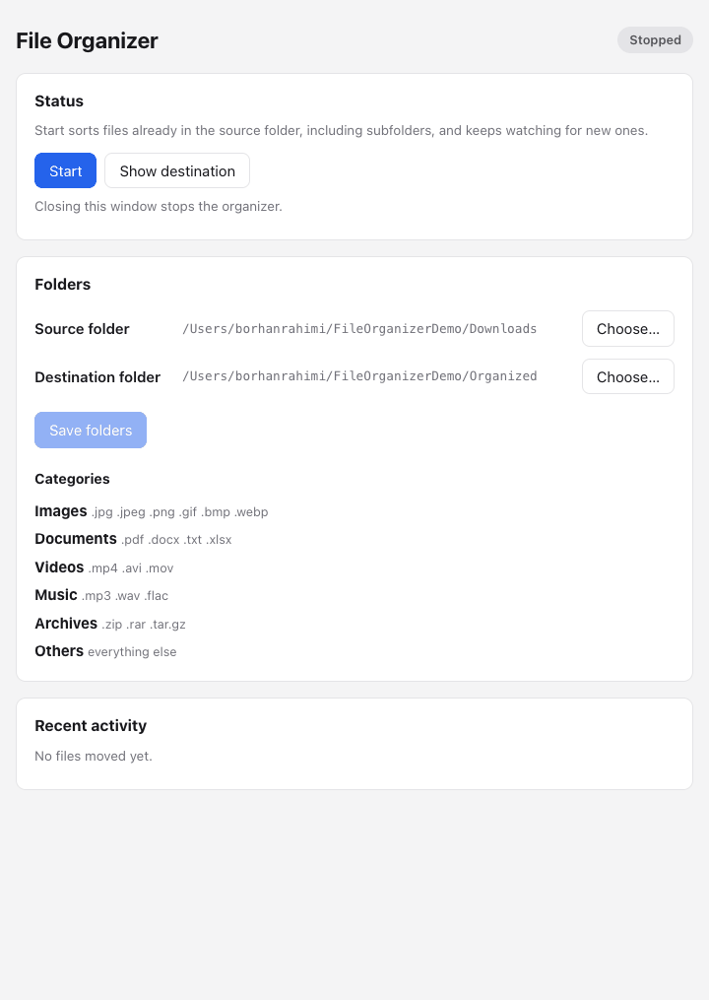

# File Organizer

[](https://github.com/borhanrahimi/file_organizer/actions/workflows/tests.yaml)


A desktop app that keeps your Downloads folder tidy on its own. It watches a
folder in real time, waits until each file has finished downloading, cleans
up the file's name, and moves it into a category folder (Images, Documents,
Videos and so on). It never overwrites anything.

<p align="center">
  
</p>

```text
Downloads/                              Organized/
  final_report FINAL (2).docx    ──►      Documents/Final_Report_Final_2.docx
  IMG 2041.PNG                   ──►      Images/Img_2041.PNG
  backup.tar.gz                  ──►      Archives/Backup.Tar.gz
  movie.mp4.crdownload           (skipped until the download finishes)
```

## Features

- **Real-time watching** of a folder and its subfolders using filesystem
  events (`watchdog`), not polling. Files already there are sorted at startup.
- **Waits for downloads to finish.** Partial downloads (`.crdownload`,
  `.part`) are skipped, and a file is moved only after it has stopped
  changing for 3 seconds.
- **Never loses data.** If a name is taken, it uses `report_1.pdf`,
  `report_2.pdf`, and so on instead of overwriting. Failed moves are retried
  and reported.
- **Configurable categories,** including multi-part extensions like `.tar.gz`.
  Unknown types go to `Others`.
- **Desktop app** (Tauri + React) to choose folders, start and stop the
  organizer, and see recent moves and errors.
- **Terminal mode** and an optional macOS LaunchAgent for running at login.

## Tech stack

| Layer | Technology |
|---|---|
| Backend | Python 3.13, FastAPI, Uvicorn, watchdog, PyYAML |
| Desktop app | Tauri 2 (Rust), React 19, TypeScript, Vite |
| Testing | pytest (87 tests), Rust unit tests |
| CI | GitHub Actions: backend tests and frontend type-check/build |

## Architecture

```text
┌────────────────── Desktop app (Tauri) ──────────────────┐
│  React UI ── HTTP + token ──┐        Rust: starts and    │
│  (polls every 2 s)          │        stops the backend   │
└─────────────────────────────┼────────────────────────────┘
                              ▼
┌──────────── Python backend (127.0.0.1 only) ────────────┐
│  api.py ─► service.py ─► watcher thread                  │
│                           │  filesystem events            │
│                           ▼                               │
│                 readiness check ─► core.py: categorize,   │
│                                    rename, move           │
│  activity.py: recent moves/errors   lock.py: one instance │
└──────────────────────────────────────────────────────────┘
```

The Tauri app starts the Python backend as a child process, with a free port
and a random token for each launch. The React interface talks to it over a
small local HTTP API. Quitting the app shuts the backend down. If the app
crashes, the backend notices and exits on its own.

More detail:
- [Architecture](docs/architecture.md): components, API, error codes, and
  file-safety rules.
- Design decisions: [why Tauri](docs/decisions/001-frontend-framework.md)
  and [how the app talks to the backend](docs/decisions/002-frontend-backend-communication.md).
- [Product plan](docs/product.md): scope and user flows.

## Engineering highlights

- **Safety first.** The backend checks every setting before it starts. It
  refuses a source folder inside the destination, and category names that
  could write outside it (`../x`). Settings files are written atomically, and
  a check that a file has stopped changing guards against moving half-written
  downloads.
- **Concurrency.** The watcher runs on a background thread and can be stopped
  safely: stopping lets a move that has already started finish. Shared state
  is protected by locks. An operating-system file lock ensures that only one
  organizer runs at a time across the app, the terminal, and the LaunchAgent,
  and it can't go stale after a crash.
- **Local API security.** The API listens on `127.0.0.1` only. It requires a
  bearer token for each launch, compared in constant time, and its CORS
  allow-list blocks other websites from calling it.
- **Tested behavior, not just functions.** Tests use an injectable clock,
  so time-based checks run instantly. Other tests simulate failed moves,
  duplicate events, and files that disappear. Process-level tests confirm that
  the server exits on `/shutdown` and when its parent app dies.
- **Documented decisions.** Architecture decision records (ADRs), a
  roadmap, and a list of known limitations show the reasoning behind the code.

## Getting started

Requirements: Python 3.10+, and for the desktop app Node.js 20+ and Rust
([Tauri prerequisites](https://tauri.app/start/prerequisites/)).

```bash
git clone https://github.com/borhanrahimi/file_organizer.git
cd file_organizer
python3 -m pip install -e ./backend
```

### Desktop app

```bash
cd frontend
npm install
npm run tauri dev
```

Choose a source and destination folder, press **Save folders**, then
**Start**. The app runs the backend with `python3`. To use another
interpreter, such as a virtual environment's, set `ORGANIZER_PYTHON`.
Closing the window stops the organizer.

### Terminal

```bash
cp config.example.yaml config.yaml   # then edit the folders and categories
python3 -m organizer
```

```yaml
watch_folder: "~/Downloads"
destination_root: "~/Organized"
categories:
  Images: [.jpg, .png]
  Documents: [.pdf, .docx]
  Archives: [.zip, .tar.gz]
```

To start it automatically at login on macOS, see
[Running in the background on macOS](docs/macos-launchagent.md).

## Running the tests

```bash
python3 -m pip install pytest httpx
python3 -m pytest backend/test -v       # 87 backend tests

cd frontend
npm run build                           # TypeScript type-check and build
(cd src-tauri && cargo test)            # app starts/stops the backend
```

To try the API by hand:

```bash
ORGANIZER_TOKEN=dev-secret python3 -m organizer.server --port 8000
curl -H "Authorization: Bearer dev-secret" http://127.0.0.1:8000/status
```

## Project structure

```text
backend/
  src/organizer/
    core.py        categorize, clean names, move without overwriting
    watcher.py     filesystem events and the processing loop
    readiness.py   wait until a file stops changing
    service.py     owns the watcher thread, state, and settings
    api.py         local HTTP API (FastAPI)
    server.py      runs the API; exits with its parent app
    activity.py    last 100 moves and errors
    lock.py        one organizer at a time
    config.py      load, validate, and save settings
  test/            pytest suite
frontend/
  src/             React interface and API client
  src-tauri/       Rust: starts and stops the backend
docs/              architecture, ADRs, product plan
```

## Roadmap

The first version is complete. Next up:

- Package the backend with the app so Python isn't required
- Menu-bar icon that keeps organizing after the window closes
- Undo history for moves
- Editing categories in the app

See [ROADMAP.md](ROADMAP.md) for the full history and known limitations.

## License

[MIT](LICENSE)
